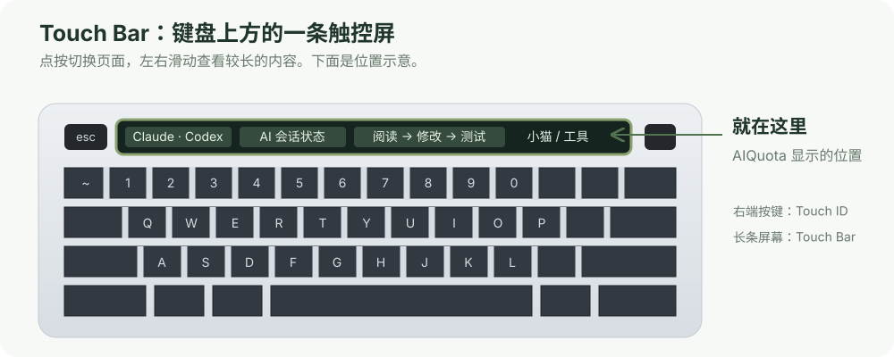
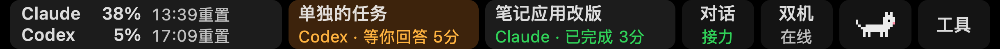
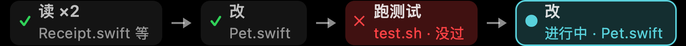
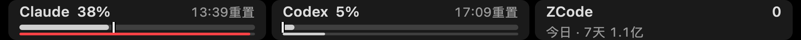
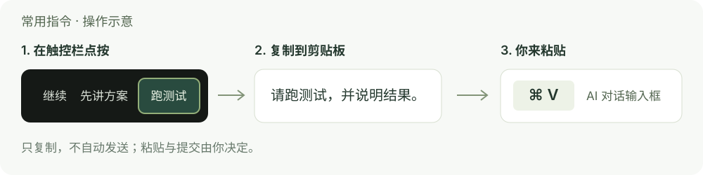
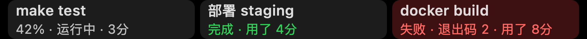
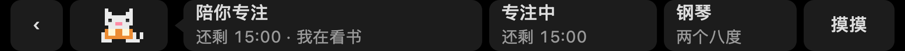
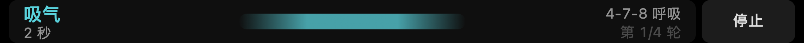
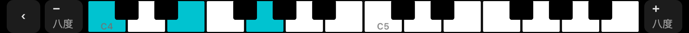

# AIQuota Touch Bar

**把 AI 的工作进展、剩余额度和一只小猫，放到 MacBook Pro 的触控栏上。**

Claude 和 Codex 同时干活时，低头就能看见谁在跑、谁在等你、哪一步出了问题。切到 AI 应用，触控栏还能显示这一轮的工作路线：读了什么、改了什么、测试过没过。

本仓库包含 AIQuota 的 **Mac 菜单栏、Touch Bar 应用和 Chrome 歌词扩展**。没有 Touch Bar 的 Apple 芯片 Mac，也可以使用菜单栏中的额度和会话功能。

[演示视频](#演示视频) · [下载源码 ZIP](https://github.com/shuai9928/aiquota-touchbar/archive/refs/heads/main.zip) · [功能图解](#功能图解) · [安装与接入](#安装与接入) · [从源码构建](#从源码构建)

源码采用 [MIT 许可](LICENSE)，可以直接下载、学习、修改和再分发；无需下载密码。第三方钢琴授权与演示配音的范围见文末和 [媒体说明](docs/media/README.md)。

## 演示视频

[](https://shuai9928.github.io/aiquota-touchbar/watch.html)

**[观看完整视频（1 分 40 秒）](https://shuai9928.github.io/aiquota-touchbar/watch.html)** · [下载 1080p MP4](https://raw.githubusercontent.com/shuai9928/aiquota-touchbar/main/docs/media/demo.mp4) · [字幕](docs/media/demo.srt) · [封面、截图与署名](docs/media/README.md)

打开播放页可观看完整 1080p 视频，也可单独下载原片。

视频由演示界面和模拟数据制作，包含工作路线、会话提醒、歌词和钢琴。不是私人聊天录屏；具体功能和使用条件以下文及源码为准。

## Touch Bar 在哪里？

Touch Bar 是部分 MacBook Pro **键盘上方的长条触控屏**。AIQuota 在这里放一个常驻小图标，点一下即可展开功能页面。



下面的功能图由应用界面绘制器使用**示例数据**生成，任务名、额度、文件名和时间用于演示，不含真实账号或聊天记录。长条图可点击查看原始尺寸。

## 功能图解

### 1. 一屏看见最需要处理的事



从左到右：**额度 → 两张优先任务卡 → 对话 → 双机 → 小猫 → 工具**。有双机集成时固定一屏七格，首页不用左右找按钮；没有该集成时不显示「双机」。

| 点哪里 | 能做什么 |
| --- | --- |
| 额度表 | 查看 Claude / Codex 的用量窗口、进度条和重置时间 |
| 任务卡 | 进入任务操作页，再打开对应 AI 会话或设置「做完叫我」 |
| 对话 | 查看更多会话、接力提示、路线入口和终端任务灯 |
| 双机 | 查看可选的 Tailscale / `two-machine` 状态与操作 |
| 小猫 | 进入小猫的家，使用专注、呼吸、歌词和钢琴 |
| 工具 | 使用常用指令、材料架、翻译等功能 |

首页优先把**等你回应、出错**的任务摆出来。平常以白灰为主：橙色提醒你回应或额度消耗较快，红色表示出错或额度快满，完成状态用绿字。会话灯支持 Claude Code、Codex 和 ZCode。

### 2. 看 AI 这一轮走到哪一步

路线图显示**当前一轮**的工作，而不是把几轮聊天混在一起。通常按阅读、搜索、修改、运行测试等实际动作整理；Claude 写出待办计划时，也能显示「已完成 → 正在做 → 下一步」。


图中一眼能看出：前两步已经完成，**现在正在修改 `Watch.swift`**，后面还有补测试和安装验证。路线图从本机会话记录里提取计划和工具执行信息，不调用模型来猜测进度。



测试失败会保留红色节点；后面继续修改时，当前步骤仍会向前更新，能看出「哪里没过、现在在修什么」。

| 路线图标记 | 含义 |
| --- | --- |
| 绿色勾号 | 这一步已经完成 |
| 青绿色实心节点 / 边框 | 当前正在进行的步骤 |
| 灰色虚线节点 | 计划中的后续步骤 |
| 橙色节点 | 正在等待你回应或批准 |
| 红色节点 | 这一步执行失败 |

**切换和查看方法：**

1. 切到 Claude 或 Codex 应用，路线图跟随对应 AI 更新。
2. 同一家 AI 有多条任务时，优先显示等你回应的任务，然后是最近在跑、最近完成的任务；它不保证就是屏幕上正在查看的那条聊天。
3. 一屏放不下时，在 Touch Bar 上**左右滑动**；新步骤通常出现在右端。你滑回前面查看时，应用会保留查看位置。
4. 点当前、等待或失败节点，可以打开相关会话。手动关闭路线图后，可从「对话 → 路线」再次打开。

路线最多保留 40 步，完成后最多保留 12 小时。当前路线图支持 Claude / Codex；ZCode 提供会话状态与用量信息。

[查看长路线图示例 →](docs/images/workflow-long.png)（原图展开了整条路线；真机上在有限宽度内左右滑动。）

### 3. 额度、重置时间和用量放在一起



菜单栏和触控栏都能看 Claude / Codex 用量。首页只显示最需要关注的窗口；进入额度页后，再看用量条、重置时间等细节。ZCode 显示本机记录的 token 用量，它不是同一口径的订阅额度百分比。

- **Claude 额度**：需要安装并登录 Claude 桌面应用，读取它在本机留下的用量记录。
- **Codex 额度**：使用本机 Codex 登录信息请求用量接口，登录文件只读，不修改。
- **数据过期或读取失败**：界面会标出未更新或错误状态，不能把旧数据当成刚刷新出的余额。

### 4. Claude ↔ Codex 接力，少做一次信息整理


同一项目交替使用 Claude 和 Codex 时，可以在触控栏查看接力状态、打开 AI 应用或交接说明。任务操作页还能打开项目文件夹、Terminal，并复制包含任务、状态、项目路径、Git 分支和已跟踪文件变更的交接摘要。

**复制后由你粘贴给另一方**。触控栏不会自动把摘要发送给 AI，也不会替你启动模型任务。使用本机 `~/.ai-handoff/` 交接文件时，相关提示会读取文件名和修改时间。

任务操作页的「做完叫我」可以订阅**这一次执行**：完成、出错或再次等待你时叫一次。有后台工作流仍在跑时，不会仅因主会话停下来就提前宣布完成；系统通知需要你已允许通知权限。

### 5. 常用指令和材料随手取

**常用指令：点一下复制，再按 ⌘V 粘贴。**



Claude / Codex / ZCode 在前台时，可以从「工具」使用常用指令。支持最多 20 条，每条最多 500 字；默认不会自动弹出，也不会自动发送。

[查看「继续、先讲方案、跑测试、解释改动、交接」等预设的完整界面 →](docs/images/prompts.png)

**材料架：暂存一段文字或一组文件路径。**


先复制文字或文件，再点材料架的添加入口；需要时点卡片取回。最多存 5 条，每条最多 64 KB，材料只留在内存中，退出应用后不会保留。它不保存图片，也不会持续监视剪贴板；只在你主动添加时读取一次，并拒绝带有密码管理器保密标记的内容。

**划词翻译：选中文字 → 右键「服务」→「在触控栏上翻译」。**

也可以从「工具 → 翻译」主动翻译剪贴板，再复制译文。使用系统本地翻译，运行时需要 **macOS 26**；对应语言包要先在系统设置中下载。中外文方向会自动判断，超过 2000 字时只处理前 2000 字。

### 6. 给终端里的测试和构建点一盏灯



接入 `tb` 命令后，把原命令放在 `tb run` 后面即可。运行时是暗灯，成功变绿，失败变红；**原命令的输入、输出和退出码保持不变**。

```bash
# 测试结束后，不用一直盯着终端
tb run --name "项目测试" npm test

# --keep 延长结果灯的保留时间
tb run --name "构建" --keep make

# 自己提供说明、状态或进度
tb light "等审核" 橙 "需要检查结果"
tb progress "导入" 45 "正在处理"

# 查看或清除任务灯
tb list
tb off "导入"
tb clear
```

进度由调用者通过 `tb progress` 提供，不是自动估算。点运行中的任务灯还可设置「做完叫我」。

### 7. 手边的小猫、专注和呼吸



小猫会随任务状态变化：忙碌、等你、出错、完成或休息；专注时可以陪你看书，听歌时也有对应状态。小猫的家还提供 **25 分钟专注 / 5 分钟休息**，以及摸摸小猫等互动。



点「呼吸」，按触控栏提示完成吸气、停留和呼气。计时、阶段和轮次直接显示在手边。

### 8. 歌词与两八度钢琴


安装配套 Chrome 扩展后，播放 Bilibili / YouTube 视频时，可在触控栏看当前行和下一行歌词。是否能找到歌词或字幕取决于视频和数据来源，并非每个视频都能匹配。



点「钢琴」，触控栏变成两个八度的黑白琴键，点按发声；左右入口可以调整八度，使用 macOS 自带钢琴音色。

## 安装与接入

### 环境要求

| 项目 | 要求 |
| --- | --- |
| 处理器 | Apple 芯片，当前发布和构建目标为 `arm64`；没有 Intel 构建 |
| 系统 | macOS 13 或更新；系统划词翻译需要 macOS 26 |
| Touch Bar | 完整体验需要配备 Touch Bar 的 MacBook Pro，例如 13 英寸 M1（2020）/ M2（2022）机型 |
| AI 集成 | 额度需要对应应用已登录；会话灯按本机安装的 Claude Code / Codex / ZCode 选择接入 |
| 歌词 | Chrome + 配套扩展，支持 Bilibili / YouTube |
| 双机 | 可选的 Tailscale 和 `two-machine`；不需要它们也能使用其他功能 |

### 使用历史安装包

源码现已公开，可直接按[从源码构建](#从源码构建)运行。原介绍页的安装包下载仍可能要求密码，与公开 GitHub 源码的访问无关。

1. 如已有历史安装包，或已获[原下载页](https://aiquota-touchbar-download.alightcloud6.chatgpt.site)的安装包下载密码，选择 **Mac 安装包**。
2. 打开 DMG，把 `AIQuota.app` 拖入「应用程序」。**从应用程序目录启动，不要直接从安装盘启动并接入 hooks。**
3. 首次打开如被系统阻止，到「系统设置 → 隐私与安全性」中允许打开。当前应用使用临时签名，尚未使用 Apple 开发者签名或公证。
4. 在欢迎窗口勾选需要的会话灯、`tb` 命令、开机启动和歌词扩展，点「设置」。以后可从菜单栏 **AIQuota → 接入…** 修改。
5. 到「系统设置 → 键盘 → 触控栏设置」开启 **显示 Control Strip**。在亮度、音量键附近找到 AIQuota 小图标，点一下展开。

接入会先备份相关配置，仅处理 AIQuota 的 hooks 条目。**Codex 的 6 条 hooks 需要你在 Codex 设置里审阅并 Trust**；已打开的 AI 会话要新开，才会使用新配置。移动应用导致 hook 命令路径改变后，也可能需要重新信任。

ZCode 接入会开启它的 hooks 总开关，因此原本关闭的其他 ZCode hooks 也可能开始运行。

### Chrome 歌词扩展

通过「接入…」准备扩展后，在 Chrome 的 `chrome://extensions` 中开启「开发者模式」，选择「加载已解压的扩展程序」，加载应用准备的 `ChromeExtension` 文件夹。源码用户也可直接加载本仓库的 `chrome/` 目录。

### `tb` 命令找不到

在「接入…」勾选 `tb` 后，命令会放到 `~/.local/bin`。如果终端提示找不到，可把此目录加入 PATH，再打开一个新的终端窗口：

```bash
echo 'export PATH="$HOME/.local/bin:$PATH"' >> ~/.zshrc
```

### 卸载

菜单栏 **AIQuota → 接入… → 卸载 AIQuota…** 会清理 AIQuota 的 hooks、`tb` 和开机启动，并可选择是否删除应用数据。也可以使用 DMG 中的「卸载 AIQuota.command」。单独把应用拖入废纸篓会留下这些接入配置。

## 从源码构建

编译需要带 **macOS 26 SDK** 的 Xcode 或 Command Line Tools。运行目标仍是 macOS 13 起，翻译功能单独检查系统版本。

仓库公开，无需 GitHub 登录或 SSH 配置；也可以直接[下载源码 ZIP](https://github.com/shuai9928/aiquota-touchbar/archive/refs/heads/main.zip)。

```bash
git clone https://github.com/shuai9928/aiquota-touchbar.git
cd aiquota-touchbar

# 仅编译，不覆盖已安装的应用，也不安装 hooks
./mac/build.sh --build-only
open mac/build/AIQuota.app
```

`--build-only` 用于编译与预览。接入会话灯前需要安装到稳定目录。需要在本机安装至 `~/Applications`、设置登录启动并运行时：

```bash
./mac/build.sh
```

该命令会替换 `~/Applications/AIQuota.app`；运行后再通过「接入…」选择 AI 集成。

### 测试与打包

```bash
./mac/test.sh
./mac/package.sh
```

测试使用临时配置目录。打包脚本默认先测试、再构建，输出到 `dist/AIQuota-<日期>-<提交>.dmg`，包含应用、应用程序快捷方式、使用说明、卸载脚本和第三方授权；不带本机登录、会话、常用指令或材料。刚完成测试且代码未变化时，可使用 `./mac/package.sh --skip-tests`。

## 数据与权限

- **会话状态来自本机。** hooks 提供运行、等待、完成等状态；路线图读取本轮本地会话记录，提取工具名、文件名、命令摘要和计划。应用不调用模型分析会话，也不把聊天全文上传到本站或 GitHub。
- **有明确的联网功能。** Codex 用量查询会访问用量接口；歌词扩展会查询歌词或字幕来源。可选双机集成使用用户配置的 Tailscale / `two-machine`。
- **剪贴板由你主动使用。** 常用指令点按复制，材料架主动添加时读取一次，翻译剪贴板也需要点按；不会持续读取剪贴板。复制交接摘要可能包含本机项目路径，由你决定粘贴给谁。
- **没有录屏要求。** 基本功能不需要辅助功能或屏幕录制授权；系统通知由用户授权。
- **公开源码不含本机配置。** 个人登录、真实会话、hooks 运行状态、常用指令和材料不随本仓库分发。请勿将运行后的个人数据、凭据或完整聊天上传到 Issue。

Touch Bar Control Strip 使用 macOS 私有接口，系统更新可能影响兼容性；AI 应用的 hooks、用量接口和本地记录格式也可能随版本变化。

## 常见问题

| 现象 | 先检查什么 |
| --- | --- |
| Touch Bar 没有 AIQuota 图标 | 机型是否带 Touch Bar；应用是否运行；键盘设置中是否显示 Control Strip |
| 有菜单栏图标，但没有会话灯 | 应用是否已安装到稳定目录；「接入…」是否勾选该 AI；Codex hooks 是否已信任；是否新开了会话 |
| 切到另一条聊天，路线图没有跟着换 | 路线图按前台 AI 和任务优先级选择，并不读取屏幕来判断当前聊天；查看对应会话和路线入口 |
| 翻译提示缺少语言 | 需要 macOS 26，并先下载相应系统翻译语言包 |
| 播放视频却没有歌词 | 扩展是否已加载，视频是否来自支持站点，以及是否有可匹配歌词或字幕 |
| 双机入口没有出现 | 这是可选集成；未安装或未配置时不会显示，其他功能可以照常使用 |
| 其他 Mac 无法用 Touch Bar 功能 | 当前没有 Intel 构建；没有 Touch Bar 的 Apple 芯片 Mac 使用菜单栏功能 |

## 仓库结构

| 路径 | 内容 |
| --- | --- |
| `mac/AIQuota.swift` | 应用入口、用量与会话模型、菜单栏和 Touch Bar 基础 |
| `mac/AIPage.swift` / `mac/Roadmap.swift` | 一屏 AI 首页、对话/额度页与工作路线图 |
| `mac/Setup.swift` | hooks、命令行、开机启动、扩展接入和卸载 |
| `mac/ProjectActions.swift` / `mac/Relay*.swift` | 任务操作、交接摘要和接力提示 |
| `mac/Prompts.swift` / `mac/Shelf*.swift` | 常用指令与材料架 |
| `mac/Pet.swift` / `mac/Calm.swift` / `mac/Piano.swift` | 小猫、专注、呼吸和钢琴 |
| `mac/tests/` | Swift 与 Chrome 扩展测试 |
| `chrome/` | 歌词扩展、原生消息桥与配套脚本 |
| `docs/images/` | README 的示例界面与位置示意图 |
| `docs/media/` | 完整演示视频、字幕、封面和截图 |

## 许可与署名

项目原创源码采用 [MIT 许可](LICENSE)。视频、配音及第三方内容不因源码许可而自动获得 MIT 授权，范围与来源见 [媒体说明](docs/media/README.md)。

触控栏钢琴改编自 [p-x9/pock-piano-widget](https://github.com/p-x9/pock-piano-widget)，其 MIT 授权全文保留在 [mac/LICENSE.piano-upstream](mac/LICENSE.piano-upstream)。
