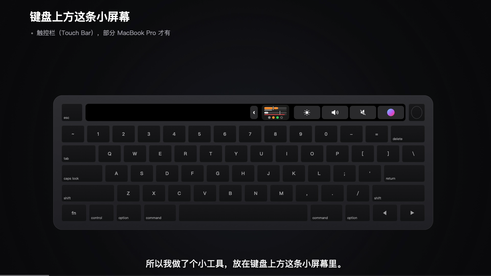
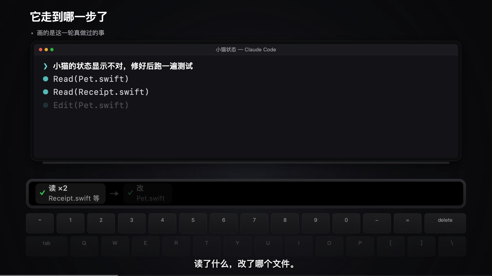
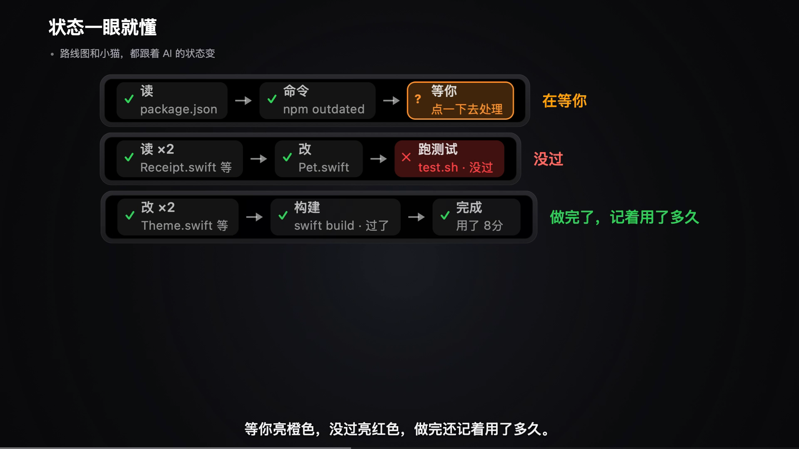

# AIQuota 演示视频与图片

[返回项目说明](../../README.md) · **[观看完整 MP4](demo.mp4)** · [下载 MP4](https://raw.githubusercontent.com/shuai9928/aiquota-touchbar/main/docs/media/demo.mp4) · [SRT 字幕](demo.srt)

成片为 AIQuota 介绍视频第六版：100.17 秒，1920×1080，30 fps，含旁白与画面字幕。视频、封面和截图随源码一起公开，获取文件无需下载密码。

## 视频截图

### Touch Bar 在哪里

### 本轮工作路线

### 等待、失败与完成

图片均为该成片的原始 1080p 视频帧，未添加真实会话或个人账号。视频中的会话、额度、文件名、任务与歌词均为演示内容；具体支持范围以项目说明和代码为准。

## 来源与署名

- 界面、分镜、原创示例歌词：本项目制作。钢琴部分的上游项目与许可见 [mac/LICENSE.piano-upstream](../../mac/LICENSE.piano-upstream)。
- 配音：曼波 AI 声线，由 MiloraAPI 的公开免费接口生成。此为实际制作来源记录，不将第三方声音或服务输出重新许可为 MIT。
- Claude、Codex、ZCode、Apple、MacBook Pro、Touch Bar 等名称或标志属于各自权利人，本项目不代表官方合作或背书。
- 根目录 [MIT LICENSE](../../LICENSE) 适用于项目源码；第三方配音、音乐、商标及其他第三方媒体不因源码许可而自动获得 MIT 授权。复用媒体时请保留来源并核对相应范围。
